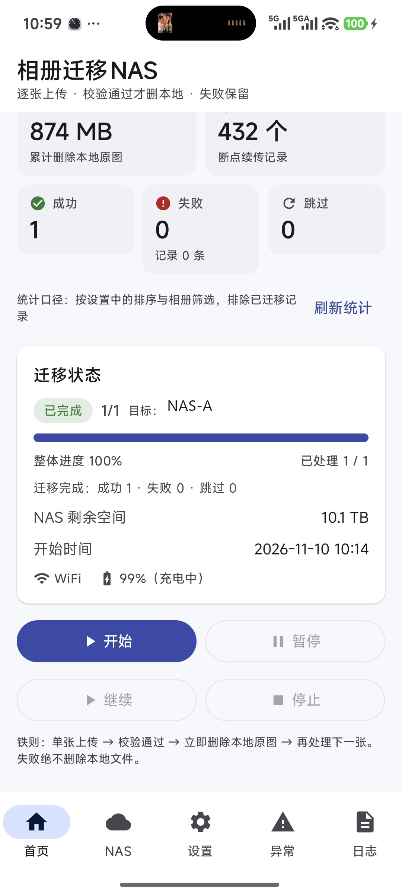
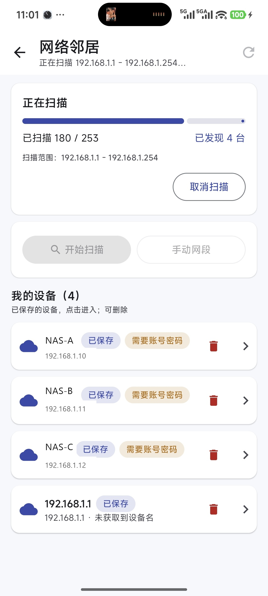
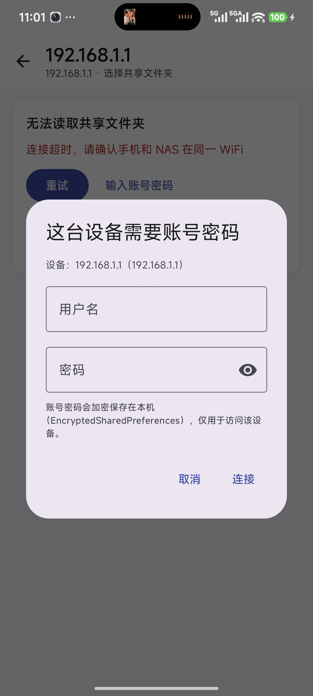

# 相册逐张边传边删迁移 NAS 工具（NAS Photo Migrator）

[](https://github.com/szscyao/nas-photo-migrator/actions/workflows/android-ci.yml)
[](LICENSE)

> Android 原生（Kotlin）· minSdk 29（Android 10）· SMB/CIFS + WebDAV · 纯本地、无账号、不联网除 NAS 之外任何地址
> 许可证：[Apache License 2.0](LICENSE) · 持续集成：[Android CI](.github/workflows/android-ci.yml)
>
> ⚠️ **免责声明（必读）**：本工具在「上传成功 + 完整性校验通过」后**删除手机本地原图**，属不可逆操作。
> 首次使用请先用 10~20 个文件试跑，确认 NAS 端文件可正常打开且大小一致；批量使用前请自行做好备份。
> 本软件按「现状」提供，不附带任何明示或暗示担保，作者不对任何数据丢失承担责任。
> 包名：`com.nasphoto.migrator`

---

## 一、这是什么

把手机本地相册里的**图片和视频逐张**迁移到你自己的 NAS，并严格遵循一条闭环：

```
取一张 → 上传到 NAS → 校验 NAS 端文件完整性（大小一致，可选 MD5）
       → 校验通过后立即删除本地原图并二次确认 → 写完成记录 → 取下一张
```

**每完成一张，手机存储空间立刻释放一点**。它不是「批量备份完再统一清理」：

- ✅ 一次只处理 1 个文件（物理单线程，绝不并发批量上传）
- ✅ 校验不通过绝不删除本地
- ✅ 上传/校验失败、断网、NAS 空间不足 → 只记失败列表，本地原图保留
- ✅ 断点续传：重启/中断后从断点继续，已完成的不重复上传
- ✅ 本地删除确认成功后才处理下一张
- 🆕 支持「**网络邻居**」向导：自动扫描本网段 SMB 设备 → 浏览共享与目录 → 需要时输入账号密码 → 一键生成配置（v1.1.0 新增，无需手填 IP / 共享名）

---

## 界面预览

<p align="center">
  
  
  
</p>

<p align="center"><sub>左：首页迁移完成态（已释放 874 MB）· 中：本网段自动扫描发现设备 · 右：设备需要认证时弹窗输入账号密码</sub></p>

---

## 二、功能一览

| 模块 | 功能 |
|------|------|
| 迁移 | 单张串行「上传→校验→删本地」闭环；自动重试 3 次（2s/4s/8s 指数退避）；失败自动继续下一张 |
| 协议 | SMB/CIFS（SMB2/SMB3，jcifs-ng）+ WebDAV（Sardine + OkHttp 流式 PUT） |
| NAS 配置 | 多套配置增删改查、连接测试、密码 AES256-GCM 加密存储、一键切换迁移目标 |
| 网络邻居 🆕 | 本网段 /24 全扫描（TCP 445 探测，32 并发，15 秒内出结果）、共享/目录浏览、按需弹窗认证、我的设备收藏、选中目录一键生成并激活配置 |
| 相册 | MediaStore 分区存储（无裸路径）、相册筛选、按拍摄时间排序、待迁移数量/大小统计 |
| 设置 | 仅 WiFi 迁移、MD5 校验开关、低电量自动暂停（阈值可调）、迁移期间保持唤醒、重置迁移记录 |
| 前台服务 | 通知栏实时显示：已完成 x/y、已释放空间、当前文件名、进度条、暂停/继续/停止 |
| 异常管理 | 失败文件列表（原因分类/时间/尝试次数）、单条重试、清空记录（不删本地文件） |
| 日志 | 本地日志、级别筛选、导出分享（含密码脱敏） |
| 安全 | 无云端/无账号/无统计上报；禁止明文密码；删除前必须校验 |

---

## 三、五分钟上手

### 1. 安装与首次授权

安装 APK 后首次打开：

1. **相册权限**：Android 13+ 会请求「照片和视频」权限；Android 10~12 请求「存储」权限；
2. **所有文件访问权限（Android 11+ 必开）**：首页会出现提示卡片 → 点进去 → 打开「**允许管理所有文件**」；
   > 原因：Android 11 起，删除其它 App 创建的相册文件必须用系统「所有文件访问」授权；否则系统会要求你**每张图都手动确认一次**，无法做到自动逐张迁移。
   > 本应用只通过 MediaStore 接口删除照片，不会直接读写文件路径。
3. **通知权限（Android 13+）**：用于在通知栏显示迁移进度。

### 2. 用「网络邻居」自动发现 NAS（推荐，v1.1.0 新增）

首页最上方的「**网络邻居**」卡片进入向导（也能从首页推荐入口进入），全程不用手填 IP 和共享名：

1. **扫描**：进入后自动读取当前 WiFi 的本机 IP，推导 /24 网段（如 `192.168.1.1~192.168.1.254`）并开始扫描；
   进度条显示「已扫描 x/y」，实测 253 个地址约 6~7 秒扫完（并发 32、单 IP 800ms、整轮上限 15 秒）；
   - 只允许在 **WiFi** 下扫描（移动网络会提示先连 WiFi）；
   - 「取消扫描」会真正中断未完成的探测（不是只停界面）；
   - 「手动网段」可填写起止 IP（跨网段/固定网段用，单次最多 1024 个地址）。
2. **选设备**：列表先显示「我的设备」（上次扫描到/连接过的设备，带“已保存”标记），随后补充本次扫描结果；
   设备名通过 NetBIOS / 反向 DNS 补全，拿不到时显示 IP；匿名访问被拒的设备会标注「需要账号密码」。
3. **选共享**：点设备 → 列出共享文件夹（如 `photo`、`homes`、`共享文档`）。
4. **选目录**：点共享 → 逐级浏览目录（面包屑可点回任意层级，文件灰显不可进入）。
5. **认证（按需）**：需要账号密码时弹出对话框（密码可切换明文）；输入正确后凭据会**加密保存**，同一设备下次自动登录；
   输错会提示「账号或密码不对，请重新输入」。
6. **一键生成配置**：在目标目录点「使用此文件夹」→ 自动生成标准 SMB 配置并设为**迁移目标** → 返回首页即可开始迁移。

> 网络邻居只负责 **SMB 设备发现/浏览**；WebDAV（群晖 5005/5006、Nextcloud 等）仍请使用下面的手动配置。
> 扫不到设备？按顺序排查：手机与 NAS 是否同一 WiFi/网段 → 路由器是否开启「AP 隔离」→ NAS 是否已开启 SMB 服务 → 445 端口是否被防火墙拦截。
> 想删除某台收藏设备：在「我的设备」条目右侧点删除（二次确认，只删收藏记录，不影响 NAS 上的任何文件）。

### 3. 手动添加 NAS（高级模式）

首页底部 → **NAS** → 点「+」新增：

#### SMB 示例（群晖 / 威联通 / OpenMediaVault / Windows 共享）
| 字段 | 填写示例 |
|------|---------|
| 协议 | SMB / CIFS |
| 名称 | 家里群晖 |
| 主机 | `192.168.1.10` |
| 端口 | `445` |
| 共享名 | `homes`（或 `photo`、`backup`） |
| 远程目录 | `PhotoBackup`（可留空 = 共享根目录） |
| 用户名 / 密码 | NAS 账号密码（支持 `DOMAIN\user` 或 `user@domain`） |

#### WebDAV 示例（群晖 WebDAV / Nextcloud / Alist）
| 字段 | 群晖示例 | Nextcloud 示例 |
|------|---------|----------------|
| 协议 | WebDAV | WebDAV |
| 主机 | `192.168.1.10` | `cloud.example.com` |
| 端口 | `5005`（HTTP）/ `5006`（HTTPS） | `443` |
| 远程目录 | `PhotoBackup` | `remote.php/dav/files/用户名/PhotoBackup` |
| HTTPS | 按端口选择 | ✅ 开启 |
| 用户名/密码 | NAS 账号 | Nextcloud 账号（建议用「应用密码」） |

> 群晖需在「套件中心 → WebDAV Server」中启用 WebDAV。
> 填完点「**测试连接**」：会验证目录可达、可写，并显示 NAS 剩余空间。

### 4. 开始迁移

1. 首页选择目标 NAS（在 NAS 页点选「激活」）；
2. 按需在**设置**里配置：仅 WiFi（默认开）、MD5 校验（默认关）、低电量暂停、相册筛选/排序；
3. 首页点「**开始**」，会先显示待迁移数量与总大小（预计释放空间），确认后开始；
4. 通知栏与首页实时显示进度；可随时**暂停/继续/停止**；
5. 全部完成或中断后，异常页可查看失败文件原因，重试后会重新处理这些文件。

### 5. 迁移过程中会发生什么

对每一张文件，App 内部严格按顺序执行：

1. 检查本地文件是否还在（被手动删了 → 跳过）；
2. 在 NAS 创建对应目录（保持相册目录结构，如 `PhotoBackup/DCIM/Camera/`）；
3. 如果 NAS 已存在同名文件：大小一致则校验后直接删本地；大小不一致则记「冲突」并**不覆盖、不删除本地**；
4. 流式上传（不占内存、不生成临时文件）；
5. 上传成功 → 重新查询 NAS 端真实大小（开启 MD5 时再比对 MD5）；
6. **校验通过** → 删除本地原图 → 再次确认已不存在 → 写完成记录 → 状态 +1；
7. 失败 → 记失败列表（本地保留）→ 继续下一张。

---

## 四、常见问题（FAQ）

**Q1：为什么后台总是被杀/暂停？**
国产 ROM（华为/小米/OPPO/vivo）默认限制后台。请按 App 内「设置 → 后台保活说明」中的步骤：关闭电池优化、允许自启动/后台活动、最近任务加锁。即使被杀，重新打开 App 点开始也会**从断点继续**，不会丢进度、不会重复上传。

**Q2：提示「需要所有文件访问权限」不给行不行？**
可以不给，但 Android 11+ 下删除相册原图需要系统逐张确认，无法自动迁移。建议开启；本应用只用 MediaStore 删除，不读取其它文件内容。

**Q3：MD5 校验要不要开？**
默认关闭。默认的「大小一致」校验已满足本工具的安全铁则；开启 MD5 更严格，但需要额外读取本地文件（和 SMB 场景下读取远端）所以更慢。WebDAV 只有 Nextcloud/ownCloud 系能拿到远端 MD5，其它服务器会自动降级为大小校验并记日志。

**Q4：迁移中断了，本地文件还在吗？**
在。**只有「上传成功 + 校验通过」的文件才会被删除**；失败/中断/暂停的文件一律保留在手机里，并出现在异常管理页。

**Q5：NAS 上有同名文件会覆盖吗？**
默认**不覆盖**：大小不一致时记「冲突」失败并保留本地。只有「同名同大小且校验一致」才视为已迁移并删除本地；或因上次中断留下的残片（远程更小且是本次上传产生）才会覆盖重传。

**Q6：会不会重复上传已完成文件？**
不会。完成记录以内容复合键（路径+文件名+大小+修改时间）保存，重启/中断后自动跳过已完成文件。

**Q7：支持 SMB1 老 NAS 吗？**
默认只协商 SMB2/SMB3（更安全、更兼容现代 NAS）。如 NAS 仅支持 SMB1，建议改用 WebDAV。

**Q8：密码安全吗？**
密码使用 Android Keystore 加密（AES256-GCM）后存入 `EncryptedSharedPreferences`，不以明文落盘，也不会出现在日志里。

**Q9：迁移时手机发热/耗电？**
逐张上传会有网络与 IO 负载，属于正常现象。可在设置里开启「低电量自动暂停」，或关闭「保持唤醒」。

**Q10：能把迁移改到电脑上的某个目录吗？**
本工具目标是 NAS 协议（SMB/WebDAV）。Windows 共享目录可直接用 SMB（主机填电脑 IP、共享名填共享文件夹名）。

**Q11：网络邻居扫不到我的 NAS？**
先确认手机连的是与 NAS 相同的 WiFi（扫描只跑 WiFi）；再检查路由器是否开启「AP 隔离/客户端隔离」、NAS 是否开启 SMB 服务、电脑/路由器防火墙是否拦了 445。仍不行可用「手动网段」直接填 NAS 所在网段。

**Q12：网络邻居支持 WebDAV 吗？**
网络邻居只做 SMB 发现与浏览。WebDAV 目标仍走「NAS」页手动添加（群晖 WebDAV 5005/5006、Nextcloud `remote.php/dav/...`）。

**Q13：设备只显示 IP、不显示设备名？**
设备名来自 NetBIOS（UDP 137）与反向 DNS。部分路由器会屏蔽 NetBIOS 广播/查询，此时按设计回退显示 IP，不影响连接与迁移。

---

## 五、从源码构建

### 环境要求

| 项 | 版本 |
|----|------|
| Android Studio | Ladybug 或更新（建议最新版） |
| JDK | 17 |
| Android SDK | Platform 35（compileSdk 35） |
| Gradle | 8.9（工程自带 wrapper，无需手动安装） |

### 构建命令

```bash
# Windows
gradlew.bat :app:assembleDebug

# macOS / Linux
./gradlew :app:assembleDebug

# 产物
app/build/outputs/apk/debug/app-debug.apk
```

单元测试（纯 JVM，无需设备）：

```bash
gradlew.bat :app:testDebugUnitTest
```

### 生成 Release 签名包

工程已配置好 release 签名（读取根目录 `keystore.properties`，该文件与 `keystore/` 目录均已在 `.gitignore` 中排除）：

```bash
gradlew.bat :app:assembleRelease
# 产物：app/build/outputs/apk/release/app-release.apk
```

安装包不入库（`.gitignore` 已排除 `/release/`），可直接下载已验证的发布包：
[**NAS-Photo-Migrator-v1.1.0.apk**](https://github.com/szscyao/nas-photo-migrator/releases/download/v1.1.0/NAS-Photo-Migrator-v1.1.0.apk)
（包名 `com.nasphoto.migrator`，versionCode 2 / versionName 1.1.0，minSdk 29 / targetSdk 35，
APK Signature Scheme v2 已签名，50.2 MB；SHA-256 `444D96633073F99CAACEF445B5EF4CDBE7CFAEAC8D69421B811F110E7781B1DC`）。

| 签名信息 | 值 |
|---|---|
| 证书 DN | `CN=NAS Photo Migrator, OU=Personal, O=NAS Photo Migrator, L=Local, ST=Local, C=CN` |
| 证书 SHA-256 | `7f2ab279f047f169590661c7e88b93c5c9bf3147a240881ded71df1ee2f748c8` |
| keystore | `keystore/nas-photo-migrator-release.jks`（PKCS12，别名 `nasmigrator`，有效期 30 年） |
| 密码配置 | `keystore.properties`（本机私密文件，**禁止提交/外发**） |

> ⚠️ **请务必备份 `keystore/nas-photo-migrator-release.jks` 与 `keystore.properties`**：丢失后将无法对已安装的 App 做覆盖升级（只能卸载重装，且迁移记录/我的设备等本地数据会清空）。
> release 包与 debug 包（`com.nasphoto.migrator.debug`）签名与包名都不同，可以并存安装。
> 出于运行期稳定性考虑，release 默认 **未开启 R8 混淆**（`isMinifyEnabled = false`）；`proguard-rules.pro` 已备好，真机回归后可自行开启。

### 构建与实测记录（v1.1.0）

| 项 | 结果 |
|----|------|
| 构建环境 | JDK 17.0.21 + Gradle 8.9（wrapper）+ AGP 8.7.3 + Kotlin 2.0.21 + compileSdk 35 |
| 命令 | `gradlew.bat :app:assembleDebug :app:testDebugUnitTest` |
| 结果 | **BUILD SUCCESSFUL**，0 error / 0 warning |
| 单元测试 | 45 个纯 JVM 用例全部通过（网段计算、IP 列表排除本机、认证失败分类、配置字段拼装、fileKey、远程路径等） |
| 产物 | `app/build/outputs/apk/debug/app-debug.apk`（versionCode 2 / versionName 1.1.0，约 66.5 MB） |

**局域网扫描实测**（在开发者家庭 WiFi 中实测；下表地址与设备名已脱敏）：
- 环境：家庭 WiFi，本机 `192.168.1.x/24`，扫描 `192.168.1.1~192.168.1.254`（排除本机共 253 个地址）；
- 参数：并发 32、单 IP 连接超时 800ms、整轮上限 15s；
- 结果：**耗时 6.51 秒**完成 253 个地址，发现 **3 台 445 端口开放**主机；
- **SMB 交互验证（用 App 内生产代码 `JcifsSmbBrowser` 跑真实局域网，非算法复刻）**：
  | 主机（脱敏） | `hostName()` | `probe()` | `listShares()` |
  |------|--------------|-----------|----------------|
  | 192.168.1.10 | `NAS-A`（NetBIOS，230ms） | `needsAuth=true`，626ms | 抛 `AUTH_REQUIRED`（Logon failure）→ UI 弹认证框 |
  | 192.168.1.11 | `NAS-B`（NetBIOS，1ms） | `needsAuth=true`，27ms | 抛 `AUTH_REQUIRED` → UI 弹认证框 |
  | 192.168.1.1 | `ROUTER-SHARE`（445 开放但非可用 SMB 服务） | 抛 `HOST_UNREACHABLE`（Failed to connect） | 抛 `HOST_UNREACHABLE` |
- 结论：设备名补全（NetBIOS）、「需要账号密码」判定、不可达分类三条链路均按设计工作；带账号密码的浏览链路需真机 + 真实 NAS 凭据验证。

> 依赖下载：首次构建需联网（`jcifs-ng` 来自 Maven Central；`sardine-android` 只在 JitPack，工程已配置仓库）。国内网络较慢时可自备镜像/代理。

---

## 六、工程结构

```
app/src/main/java/com/nasphoto/migrator/
├── protocol/        # NAS 协议适配：NasClient 接口 + SMB(jcifs-ng) + WebDAV(sardine+OkHttp)
├── data/
│   ├── gallery/     # MediaStore 相册查询/筛选/统计/删除 + fileKey（断点续传键）
│   ├── config/      # NAS 多配置（加密存储）+ 迁移设置
│   ├── record/      # Room：已完成记录 / 失败记录 / 日志
│   └── neighbor/     # 🆕 网络邻居：我的设备 Room 表 + 邻居凭据加密仓库 + 配置工厂
├── business/
│   ├── engine/      # 迁移引擎：单线程串行调度器 + 单文件闭环管线 + 重试策略
│   ├── verify/      # 完整性校验（大小 + 可选 MD5）
│   ├── guard/       # 网络 / 电量 / 权限守卫
│   ├── service/     # 前台服务 + 通知栏
│   ├── discovery/    # 🆕 网络邻居：/24 扫描器（TCP 445）+ SMB 只读浏览 + 认证失败分类
│   ├── log/         # 本地日志门面
│   └── model/       # 状态机与结果模型
├── ui/              # Compose 五页：首页 / NAS配置 / 设置 / 异常管理 / 日志
│   └── neighbor/     # 🆕 网络邻居向导：扫描页 / 共享列表 / 目录浏览 / 认证弹窗
├── di/AppContainer  # 手动依赖注入容器
└── MigratorApp.kt   # Application 入口
```

设计文档见同目录：

- `阶段1-架构设计与技术方案确认.md`
- `阶段2-底层基础模块交付.md`
- `阶段3-核心迁移引擎交付.md`
- `阶段4-UI界面交付.md`
- `阶段5-异常适配与整合验证.md`
- `调研-GitHub现有项目与复用决策.md`
- `需求-网络邻居向导开发任务单.md`（v1.1.0 网络邻居需求与验收）

---

## 七、隐私与许可

- **隐私**：不收集任何数据、不上传任何信息到第三方服务器、无广告/统计/崩溃上报；所有记录仅存本机（Room 数据库与加密 SharedPreferences）。卸载即清除。
- **网络邻居的扫描范围**：只对**当前局域网**做 TCP 445 端口探测与只读的 SMB 共享/目录浏览，不发起任何外网请求；扫描结果只保存在本机「我的设备」表，可随时删除。
- **第三方库**：
  - `eu.agno3.jcifs:jcifs-ng:2.1.10`（LGPL-2.1，以未修改的 Maven 依赖形式动态链接使用）
  - `com.github.thegrizzlylabs:sardine-android:0.9`（Apache-2.0）
  - `com.squareup.okhttp3:okhttp:4.12.0`（Apache-2.0）
  - Jetpack Compose / Room / AndroidX Security（Apache-2.0）
- 本应用为自研实现：协议库直接引入，**「上传→校验→删除」串行迁移引擎、MediaStore 相册管理、前台服务与断点续传均为自研代码**（调研结论：开源社区无现成实现可直接复用）。
