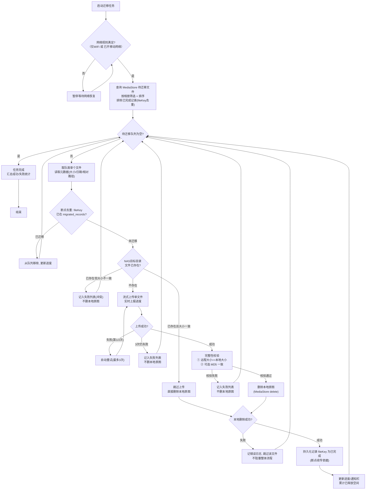

# 安卓相册NAS逐张边传边删迁移APP —— 阶段1：架构设计与技术方案确认

> 项目代号：NAS相册迁移（package: `com.nasphoto.migrator`）
> 开发方式：Android 原生 + Kotlin，minSdk 29（Android 10）
> 本文档为阶段1交付物，锁定后再进入阶段2代码开发。

---

## 0. 项目总览与三大铁则

**目标**：将手机本地相册的图片/视频**逐张**迁移至用户指定NAS服务器，严格实现「单张上传成功 → 校验NAS存储完整性 → 立即删除本地原图 → 再处理下一张」的串行闭环，每完成一张立即释放手机存储空间。

**三大铁则（任何优化不得修改，后续所有阶段以本条为最高约束）**：

| # | 铁则 | 工程实现落点 |
|---|------|------------|
| R1 | 单线程串行执行，同一时间仅处理1个文件，禁止并发批量上传 | 迁移引擎单一消费者协程 + 命令队列（见 2.2） |
| R2 | 校验通过才可删除：至少校验文件大小一致，可选MD5；校验通过后才删除本地原图 | 删除动作位于完整性校验通过分支之后（见 2.1 流程图） |
| R3 | 失败绝不删除本地：上传失败/校验失败/网络中断 → 仅记入失败列表，继续下一张 | 每个失败分支均以「保留本地、记入失败表」收尾 |

---

## 1. 项目分层架构设计

### 1.1 分层总览（四层，单向依赖）

```
┌─────────────────────────────────────────────────────┐
│  UI层（Presentation）                                │
│  首页 / NAS配置页 / 设置页 / 异常管理页 / 日志页        │
│  Jetpack Compose + MVVM（ViewModel + StateFlow）     │
└──────────────────────────┬──────────────────────────┘
                           │ 依赖
┌──────────────────────────▼──────────────────────────┐
│  业务层（Domain/Business）—— 核心迁移引擎              │
│  MigrationEngine（状态机）                           │
│  MigrationScheduler（单线程调度器）                   │
│  FileProcessPipeline（单文件处理闭环）                 │
│  IntegrityVerifier（大小/MD5 校验）                   │
│  NetworkMonitor / PowerMonitor（网络与电量守卫）       │
└──────────┬────────────────────────────┬─────────────┘
           │ 依赖                        │ 依赖
┌──────────▼──────────────┐  ┌───────────▼─────────────┐
│  协议适配层（Protocol）   │  │  数据存储层（Data）        │
│  NasClient 统一接口      │  │  GalleryRepository       │
│  ├─ SmbNasClient        │  │   （MediaStore 相册读写）  │
│  │   (jcifs-ng)         │  │  NasConfigRepository     │
│  └─ WebDavNasClient     │  │   （EncryptedSharedPrefs）│
│      (sardine-android)  │  │  RecordRepository        │
│                         │  │   （Room：已完成/失败/日志）│
└─────────────────────────┘  └──────────────────────────┘
```

### 1.2 各层职责与关键类

| 层 | 职责 | 关键类/组件 | 禁止事项 |
|----|------|------------|---------|
| **UI层** | 页面渲染、用户操作入口、状态展示；只观察 ViewModel 暴露的 StateFlow，不直接触碰业务与存储 | `HomeScreen`、`NasConfigScreen`、`SettingsScreen`、`FailureScreen`、`LogScreen`；各 `XxxViewModel` | 不直接调用 NAS 客户端或 MediaStore；不做任何文件传输逻辑 |
| **业务层** | 迁移任务全生命周期：启动/暂停/继续/停止；单文件闭环编排；重试策略；完整性校验；网络/电量/权限守卫 | `MigrationEngine`（状态机 RUNNING/PAUSED/STOPPED）、`MigrationScheduler`（Channel 命令队列 + 单一消费者协程）、`FileProcessPipeline`、`IntegrityVerifier`、`RetryPolicy`（3次） | 不感知具体协议实现；不做 UI 操作 |
| **协议适配层** | 屏蔽 SMB/WebDAV 差异，向上提供统一接口 | `NasClient`（interface）、`SmbNasClient`、`WebDavNasClient`、`NasFileInfo`、`NasException` | 不访问相册数据；不落盘业务记录 |
| **数据存储层** | 相册读取/删除（MediaStore）、NAS 配置加解密存储、迁移记录/失败记录/日志持久化 | `GalleryRepository`、`NasConfigRepository`、`MigrationRecordDao`、`FailureRecordDao`、`LogDao` | 不包含迁移决策逻辑 |

### 1.3 模块/包结构（阶段2起按此落盘）

```
app/src/main/java/com/nasphoto/migrator/
├── ui/
│   ├── home/        # 首页：状态、统计、启动/暂停/停止
│   ├── nas/         # NAS配置页
│   ├── settings/    # 设置页（网络/顺序/校验/自动迁移）
│   ├── failures/    # 异常管理页
│   ├── logs/        # 日志页
│   └── theme/
├── business/
│   ├── engine/      # MigrationEngine, MigrationScheduler, FileProcessPipeline
│   ├── verify/      # IntegrityVerifier
│   ├── guard/       # NetworkMonitor, PowerMonitor, PermissionGuard
│   ├── model/       # MigrationItem, MigrationStatus, FileProcessResult
│   └── service/     # MigrationForegroundService
├── protocol/
│   ├── NasClient.kt / NasFileInfo.kt / NasException.kt
│   ├── SmbNasClient.kt
│   └── WebDavNasClient.kt
└── data/
    ├── gallery/     # GalleryRepository（MediaStore 查询/删除）
    ├── config/      # NasConfigRepository（加密）
    └── record/      # Room：MigrationRecordDao / FailureRecordDao / LogDao / db
```

---

## 2. 核心迁移全流程图

### 2.1 主链路全流程图（含全部关键分支）



### 2.2 异常/边界分支明细（与阶段5异常适配对应）

| 场景 | 触发检测 | 行为 | 本地原图 |
|------|---------|------|---------|
| 网络中断（传输中） | `NetworkCallback.onLost` | 立即暂停任务；网络恢复且符合规则时自动续传当前文件（重新上传，NAS端已传部分覆盖） | 保留 |
| NAS 空间不足 | 上传前查远程剩余空间（SMB `diskFreeSpace` / WebDAV 无直接接口则用上传失败码+告警兜底） | 停止任务 + 弹窗告警 | 保留 |
| 权限丢失（相册/存储） | 每次读取/删除前检查 `checkSelfPermission` | 暂停任务 + 引导重新授权 | 保留 |
| 低电量 <20% | `BatteryManager` 广播监听 | 自动暂停；充电后手动/自动恢复（设置可关） | 保留 |
| 本地删除失败 | `ContentResolver.delete` 返回0或抛异常 | 记错误日志，跳过该文件，不阻塞流程 | 保留 |
| 任务中断/进程被杀/重启 | 启动时读取 `migrated_records` | 从断点继续，已完成文件不再上传（fileKey 去重） | 保留 |
| 文件已被用户删除 | 查询 MediaStore 时 ID 已不存在 | 视为已处理，跳过 | — |

### 2.3 串行执行保证（R1 的工程实现）

- **单一消费者**：`MigrationScheduler` 内部一个 `Channel<Command>`（Start/Pause/Resume/Stop），一个 `coroutineScope(Dispatchers.IO.limitedParallelism(1))` 内的单一消费者协程独占消费，物理上不存在第二个执行者。
- **删完才进下一张（R1 的最终确认点）**：主循环中「删除成功 → 持久化完成记录 → 取下一文件」三步是同一协程内的顺序语句；只有删除并确认（`delete` 返回行数>0 且 `pending` 状态不再存在）后，循环才进入下一轮取文件。
- **与常规备份的本质区别**：无「批量上传完成后再统一清理」逻辑；清理动作只存在于单文件校验通过分支内。

---

## 3. 技术选型清单（坐标/版本均已核实）

| 模块 | 选型 | 依赖坐标 | 版本/状态 | 说明 |
|------|------|---------|----------|------|
| SMB/CIFS 协议 | **jcifs-ng** | `eu.agno3.jcifs:jcifs-ng:2.1.10` | Maven Central，当前最新稳定版 | 纯Java实现，支持 SMB2/SMB3（适配现代 NAS，群晖/威联通/OpenMediaVault），`SmbFile` 提供流式读写、`length()`、`exists()`、`mkdirs()`、`getDiskFreeSpace()` |
| WebDAV 协议 | **sardine-android** | `com.github.thegrizzlylabs:sardine-android:0.9` | Maven Central，Android 专用 fork（2025-04 发布） | `put()` 流式上传、`list()`/`exists()`（PROPFIND）、`getContentLength` 远程大小获取；原生适配 Android HTTP 栈 |
| 加密存储 | **EncryptedSharedPreferences** | `androidx.security:security-crypto:1.1.0-alpha06` | AndroidX Security | 密码等敏感配置用 Keystore 主密钥 AES256-GCM 加密落盘，杜绝明文；备选方案：Android Keystore + 自封装 AES/GCM（若不接受 alpha 依赖） |
| 前台服务 | 系统 `Service` + `NotificationCompat` | 平台 API（`android:foregroundServiceType="dataSync"`） | API 28+ 需 FOREGROUND_SERVICE；API 34+ 需 FOREGROUND_SERVICE_DATA_SYNC | 通知栏实时进度：已完成数量/已释放空间/当前文件名/进度条；API 35 dataSync 单次 6 小时上限 → 超长任务按「服务内续跑+超限重启」策略处理（阶段5细化） |
| UI 框架 | Jetpack Compose + Material 3 | `androidx.compose.*`（BOM 2025.x） | 稳定版 | 单 Activity + Compose Navigation |
| 异步/串行 | Kotlin Coroutines + Flow | `org.jetbrains.kotlinx:kotlin-coroutines-android`（1.9.x） | 稳定版 | 调度器用 `Channel` + 单消费者协程实现物理串行 |
| 本地持久化 | Room | `androidx.room:room-runtime`（2.7.x）+ ksp 编译器 | 稳定版 | 三张表：已完成记录 / 失败记录 / 日志；查询用 `@Query` 索引 fileKey |
| 生命周期 | ViewModel + Lifecycle | `androidx.lifecycle:lifecycle-viewmodel-compose` | 稳定版 | MVVM 状态持有 |
| 媒体元数据 | MediaStore 内置列（`DATE_TAKEN`/`SIZE`/`RELATIVE_PATH`） | 平台 API | — | 无需额外 EXIF 库，排序直接用 `DATE_TAKEN` |
| DI | Hilt（或手动依赖注入） | `com.google.dagger:hilt-android`（2.5x） | 可选，阶段2定 | 规模可控，倾向手动注入降低构建复杂度 |

> 已核实：jcifs-ng 2.1.10（Maven Central，2026-06 更新）、sardine-android 0.9（Maven Central，2025-04 更新）。

---

## 4. 系统权限清单

| 权限 | 适用 API 范围 | 申请时机 | 适配说明 |
|------|-------------|---------|---------|
| `INTERNET` | 全部 | Manifest 静态声明 | 网络通信 |
| `ACCESS_NETWORK_STATE` / `ACCESS_WIFI_STATE` | 全部 | Manifest 静态声明 | WiFi/移动网络检测（`ConnectivityManager` + `NetworkCallback`） |
| `READ_EXTERNAL_STORAGE` | API 29–32（`maxSdkVersion="32"`） | 首页首次进入时运行时申请 | Android 10–12L 读取相册媒体；API 33+ 被拆分权限取代 |
| `READ_MEDIA_IMAGES` + `READ_MEDIA_VIDEO` | API 33+ | 首页首次进入时运行时申请 | Android 13+ 按媒体类型授权 |
| `WRITE_EXTERNAL_STORAGE` | 仅 API 29（`maxSdkVersion="29"`） | Android 10 上删除原图前申请 | Android 10 删除非本应用媒体文件所需；API 30+ 此权限无效（分区存储强制） |
| `MANAGE_EXTERNAL_STORAGE` | API 30+ | 首次启动迁移前，跳系统「所有文件访问」设置页引导 | **关键决策**：Android 11+ 用 `MediaStore.createDeleteRequest()` 每张图都弹系统确认框，无法做到自动逐张删除；自用工具（侧载分发）采用一次性授权「所有文件访问」，授权后 `ContentResolver.delete` 直接删除、无弹窗。**仍严格走 MediaStore API，禁止裸路径访问**。备注：若未来上架 Google Play 需提交声明并通过审核 |
| `POST_NOTIFICATIONS` | API 33+ | 首次启动前台服务前运行时申请 | 通知栏迁移进度 |
| `FOREGROUND_SERVICE` | API 28+ | Manifest 静态声明 | 前台服务基础权限 |
| `FOREGROUND_SERVICE_DATA_SYNC` | API 34+ | Manifest 静态声明 | 数据传输型前台服务（Android 14+ 强制） |
| `REQUEST_IGNORE_BATTERY_OPTIMIZATIONS` | API 23+ | 设置页「电池优化白名单」引导（跳系统设置，不强制申请） | 后台保活；华为/小米/OPPO/vivo 自启动/电池策略白名单引导文案在阶段5输出 |
| `WAKE_LOCK`（可选） | 全部 | Manifest 静态声明 | 传输期间 `PARTIAL_WAKE_LOCK` 防息屏断网（默认开启，设置可关） |

---

## 5. 关键设计决策（已定，阶段2起执行）

1. **删除方案**：API 29 走 `WRITE_EXTERNAL_STORAGE` + `ContentResolver.delete`；API 30+ 走 `MANAGE_EXTERNAL_STORAGE` 一次性授权 + `ContentResolver.delete`（MediaStore URI 操作，零裸路径）。放弃 `createDeleteRequest` 逐张弹窗方案（违背自动逐张迁移的产品前提）。
2. **断点续传标识（fileKey）**：MediaStore `_ID` 在索引重建后可能变化，不稳定。采用复合键：`MD5(RELATIVE_PATH + "|" + DISPLAY_NAME + "|" + SIZE + "|" + DATE_MODIFIED)` 作为唯一标识，存入 `migrated_records` 表。重启后重查 MediaStore、生成 fileKey、与记录表差集得到剩余队列。
3. **完整性校验**：默认大小校验（远程 `length()` / `getContentLength()` == 本地 `SIZE`）；MD5 校验为设置项开关（默认关，开启后本地流式算 MD5 与远程对比，代价是每张多读一遍本地文件）。
4. **重试策略**：上传失败自动重试 3 次（指数退避 2s/4s/8s），3 次仍失败 → 失败列表（含原因分类：连接失败/鉴权失败/空间不足/超时），不删除本地，继续下一张。
5. **进度与释放空间统计**：待迁移总大小 = 队列文件 `SIZE` 之和（预计可释放空间）；已释放空间 = 累计删除成功文件大小之和。由引擎以 `StateFlow<MigrationState>` 推送给 UI 与通知栏。
6. **NAS 多配置**：`NasConfigRepository` 存多套配置（服务器/端口/用户名/密码/远程目录），密码经 EncryptedSharedPreferences 加密；同一时间仅启用一套作为迁移目标。

---

## 6. 阶段1验收标准核对

| 验收项 | 是否满足 | 依据 |
|--------|---------|------|
| 核心流程明确体现「串行执行」 | ✅ | 2.1 流程图单文件闭环 + 2.3 单消费者协程、删完才取下一文件 |
| 核心流程明确体现「校验通过才删除」 | ✅ | 2.1 图中删除动作（R）仅位于完整性校验通过（P）之后 |
| 核心流程明确体现「失败不删除」 | ✅ | 上传失败/校验失败/网络中断/空间不足分支均保留本地、仅记失败列表 |
| 覆盖全部分支 | ✅ | 成功、失败、重试、文件已存在（一致/不一致）、任务中断、网络异常、空间不足、权限丢失、低电量、删除失败（2.1 + 2.2） |
| 技术选型明确 | ✅ | 第3节，坐标与版本已核实 |
| 权限清单完整 | ✅ | 第4节，含申请时机与 API 适配 |

---

## 7. 待确认事项

以下为不影响阶段1结论、但需要你拍板的两个选择（可默认）：

1. **删除授权方案**：API 30+ 采用「所有文件访问」一次性授权（推荐，无弹窗、自动逐张删除）。若你坚持完全不加 MANAGE_EXTERNAL_STORAGE，则改为每张图弹系统确认框，无法全自动。
2. **包名/应用名**：默认 `com.nasphoto.migrator` / 「NAS相册迁移」，可改。

**阶段1交付完成。确认无误后，进入阶段2：底层基础模块开发（NAS协议适配 + 相册管理 + 本地配置持久化）。**
